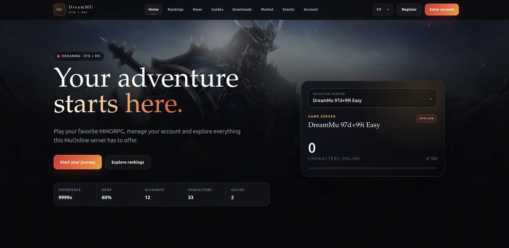

# MuOnline Web

MuOnline Web is a free, MIT-licensed Laravel website, player account panel and
administration suite for version-aware MuOnline servers, with strict legacy
database boundaries and auditable operations.

## Features

- Responsive bilingual public site, account panel and administration.
- Rankings, profiles, events, news, guides and downloads.
- Previewed character services, inventories and multi-vault storage.
- Credits, payments, VIP, votes, banks, Market, Auctions and Web Shop.
- Exact-item custody, recovery workflows and immutable audit history.
- Directory-based, update-safe Blade themes with partial overrides.

Read the [complete project documentation](docs/README.md) for installation,
configuration, compatibility, development and testing guidance.

## Support the project

If MuOnline Web is useful to your server or community, you can support ongoing
development through:

- [Buy Me a Coffee](https://buymeacoffee.com/interweb.bg)
- [Ko-fi](https://ko-fi.com/interwebltd)
- [PayPal](https://paypal.me/interwebltd)
