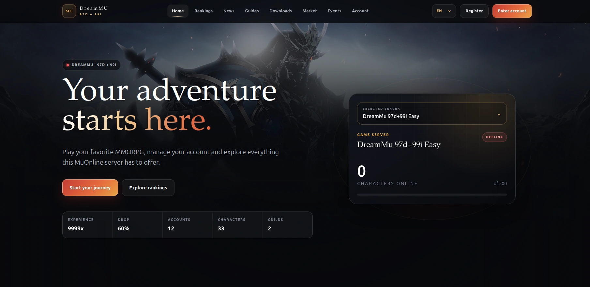

# MuOnline Web

MuOnline Web is a free, MIT-licensed Laravel website, player account panel and
administration suite for version-aware MuOnline servers, with strict legacy
database boundaries and auditable operations.

## Features

- Bilingual public site, player accounts and administration.
- Rankings, profiles, events and configurable character services.
- Inventories, banks, Market, Web Shop and auditable Credits operations.
- Isolated adapters for DarksTeam 97d+99i, 1.0M, MuEMU S6 and MUDevs S21.1–2.
- Extendable Blade themes and Docker deployment.

## Install with MuOnline Web Manager

Install and manage MuOnline Web on Windows with **MuOnline Web Manager**.

[Download MuOnline Web Manager](https://mega.nz/file/eFMFlZpS#R2T1iPSjXT7faTfhDy6CHrDKuujMivODo50m8Ati2Fs)

[Installation instructions and video](https://github.com/iwebbg/muonline-web-manager/blob/main/INSTALLATION_GUIDE.md)

Supported operating systems (64-bit):

- Windows 10
- Windows 11
- Windows Server 2022 with Desktop Experience
- Windows Server 2025 with Desktop Experience

Minimum requirements: **2 GB RAM**, **1 CPU/vCPU** and approximately **10 GB
of storage**.

## Documentation

Start with the [documentation index](docs/README.md):

- [Installation](docs/installation.md)
- [Features and compatibility](docs/features.md)
- [Themes](docs/themes.md), [payments](docs/payments.md) and [testing](docs/testing.md)

## Help & Support

[Report a bug or request a feature](https://github.com/iwebbg/muonline-web-laravel/issues).
The administration panel also includes **Help & Support**.

## License

[MIT License](LICENSE). Created by **InterWeb Ltd.** See the
[compatibility reference](docs/reference-sources.md) for third-party ownership.

## Support the project

If MuOnline Web is useful to your server or community, you can support ongoing
development through:

- [Buy Me a Coffee](https://buymeacoffee.com/interweb.bg)
- [Ko-fi](https://ko-fi.com/interwebltd)
- [PayPal](https://paypal.me/interwebltd)
